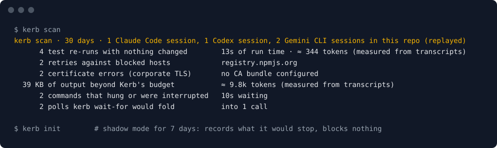

<p align="center">
  
</p>

<h3 align="center">Keeps your coding agent on the road.</h3>

<p align="center">
  Kerb stops AI coding agents from wasting turns on actions your environment forbids<br>
  and on retries that cannot help, and shows you every save.
</p>

<p align="center">
  <a href="https://github.com/eeshwarantharan/kerb/actions/workflows/ci.yml"></a>
  <a href="https://www.npmjs.com/package/kerb-cli"></a>
  
  
  <a href="LICENSE"></a>
</p>

<p align="center">
  <a href="#try-it-safely"><b>Install</b></a> ·
  <a href="#works-with"><b>Works with</b></a> ·
  <a href="#boundaries"><b>Boundaries</b></a> ·
  <a href="#for-platform-teams"><b>Platform teams</b></a> ·
  <a href="docs/KERB.md"><b>Spec</b></a> ·
  <a href="docs/KERB-V2.md"><b>v2 plan</b></a> ·
  <a href="#faq"><b>FAQ</b></a>
</p>

---

<p align="center">
  
  <br><sub><code>kerb scan</code> on the sample transcripts in <a href="test/fixtures/scan/">test/fixtures/scan</a>. Run it in your repo to see your own; it reads local files only.</sub>
</p>

## Who it's for

**You use a coding agent: see what it wasted last month, then stop it.** `kerb scan` replays your past Claude Code, Codex and Gemini CLI sessions and counts the test re-runs that couldn't help, the retries against walls, the certificate errors and the hung commands. `kerb init` then runs in shadow mode for a week: it records what it would have stopped and blocks nothing, until you turn it on.

**You work behind a corporate network: your agent learns the walls instead of hitting them.** Kerb refuses blocked registries and hosts before the command runs and names the approved mirror. It recognises TLS interception, proxy block pages and expired credentials as environment problems, so the agent stops debugging code that isn't broken, and points each tool at your company CA bundle. It never suggests turning certificate checks off.

**You run a platform team: give every agent the company's rules, signed, and see which walls they hit.** A signed policy bundle reaches every developer's agent through managed config. Learned denials come back for review as a policy patch, and telemetry (off by default) goes only to your own collector.

## What the agent sees

Each refusal is three lines, arrives before the command runs, and names the next step. An environment failure gets a fix line instead of another debugging attempt:

```
kerb: policy_blocked · registry.npmjs.org is blocked here
      source: org policy v42 · Public registries are blocked; use the internal mirror.
      next: use https://npm.corp.internal instead

kerb: identical_retry · nothing relevant changed since this failed
      matches run 0muomskqv002xs (ordinary) · FAIL src/cart.test.js › applies the discount
      next: change something first, or run `kerb diff` to compare attempts

kerb: environment · TLS interception: a proxy re-signs HTTPS with a company CA this tool does not trust; not a code problem
      next: retry with PIP_CERT=/etc/company/ca.pem for this command (company CA bundle from org policy v42)
```

> [!NOTE]
> **0.7 is a preview.** Everything in the [spec](docs/KERB.md) and milestones A to F of [v2](docs/KERB-V2.md) (shadow mode, `kerb scan`, the environment classifier, restorable states, the [KER record format](docs/KER.md), test-level results for eleven tools, deltas, verification status, convergence, the attempt ledger, instant answers, last green, cause isolation, proven fixes, `kerb query`, the MCP server, plugins and the skills pack) is built and tested on macOS and Linux. Windows is experimental. A full hooked dogfooding session and the savings benchmark come before 1.0. Please [report any false refusal](https://github.com/eeshwarantharan/kerb/issues/new?template=false-refusal.md).

## Try it safely

```bash
brew install eeshwarantharan/tap/kerb   # macOS and Linux
# or download a binary from Releases (checksums and build provenance attached)
# or: npm install -g kerb-cli           # Node 20+; the command is still `kerb`

cd my-repo
kerb scan                             # what Kerb would have caught in your past sessions (replayed)
kerb init                             # hooks, status line, skill, AGENTS.md block; shadow mode for 7 days
kerb doctor                           # everything green, or the exact fix
```

`kerb init` prints every file it changed, which agents are **enforced** (native hook) or **best effort** (instructions only), and how to undo it (`kerb uninstall`). The standalone binary is the recommended install: hooks call it by absolute path, so Node version managers never get in the way, and it starts faster (see [Honest numbers](#honest-numbers)).

**Shadow mode.** For the first 7 days Kerb refuses nothing. Every refusal it would have made is recorded, the recap says `would have stopped 4 re-runs and 1 blocked retry`, and insights (hints, environment fixes) still reach the agent. After 7 days, or 20 would-be refusals, the recap asks you once to look:

```bash
kerb review-shadow     # each command it would have stopped, the evidence, and what happened when it ran anyway
kerb enforce           # turn blocking on (you type a code; an agent can't)
kerb mode              # which mode, since when, and what it would have stopped
```

A managed config can set `mode: enforce` for a whole organisation.

`kerb --help` shows the six commands above (`init`, `scan`, `status`, `report`, `enforce`, `doctor`); `kerb help all` shows the rest.

## Demo

A recording lands here with the first tagged release. Until then, the scripted scenario is in [`demo/`](demo/): a blocked registry, a test database that starts late, a real test failure, and the recap. Run it yourself:

```bash
sh demo/setup.sh /tmp/kerb-demo && cd /tmp/kerb-demo && kerb init
```

## Why

Agents burn paid turns hitting walls (blocked registries, hosts and protected branches), going in circles (re-running a failing test with nothing changed, or returning to a state that already failed), drowning in noise (progress bars and 50,000-line logs) and hanging (watch modes, prompts, servers). Every retry re-sends the whole conversation, so these are the most expensive tokens an agent spends, and they buy nothing. Kerb refuses the call before it runs, says why in one line, and names the next step.

## What it does

| | |
|---|---|
| **Boundary Map** | Knows what your environment forbids (registries, hosts, programs, protected branches), refuses before the command runs, and names the approved alternative. Learns new walls from real policy denials, so each one is hit once. |
| **Loopbreaker** | Judges retries by the actual state of your files and environment, not by the command text. Refuses re-runs that can't change the result, returns to a state that already failed, and the same failure over and over despite edits. Lets legitimate retries through. |
| **Environment classifier** | TLS interception, corporate proxy block pages and expired credentials are recorded as environment failures: never counted as loops, and answered with a fix line (your company CA bundle for this tool, or "ask the user to re-authenticate"). |
| **`kerb scan`** | Replays past agent sessions from local transcripts and shows what Kerb would have stopped, with tokens measured from the transcripts' own usage records where they have them. |
| **Shadow mode** | The first week records instead of refusing, so you can check every would-be refusal before turning blocking on. |
| **Insight** | After each test run, what changed: tests fixed, still failing, newly failing, flaky. Whether the last result still matches the files (green, red or stale), the failing trend per command (`kerb progress`), and a ledger of what was tried that survives compaction (`kerb ledger`). Optionally, a stop gate that won't let the agent finish on stale tests. |
| **Instant answers** | A static check (tsc, ESLint, Ruff, mypy, …) asked to run again on the same files and environment gets the recorded result straight away, instead of a refusal or a re-run. |
| **Last green** | `kerb green` finds the newest state where the tests passed and what changed since; `kerb restore <state> --patch` writes a patch back to it without touching your files. |
| **Cause isolation** | When a test that passed starts failing, a background worker finds which of your edits broke it, in a separate worktree, and confirms it: `kerb: cause · "logout clears session" broke at attempt 4 · culprit: src/session.ts:88–95 (1 of 6 hunks)`, with a patch that reverts just that. Static checks by default; tests once you turn it on. |
| **Proven fixes** | A failure you fixed before is recognised when it comes back, with a pointer to the fix (`kerb show fix:<id>`). Committed fixes can be shared with your team through git notes, as fingerprints only. |
| **MCP and query** | `kerb mcp` lets agents ask read-only questions (is verification green, what was tried, has this been fixed before) over MCP; `kerb query` and `kerb export` give the same answers as JSON. `kerb init` registers the server where the agent supports MCP. |
| **Skills** | `kerb-diagnose` (a debugging loop over Kerb's records) and `kerb-before-done` (never claim tests pass unless they're green), as a Claude Code plugin or with `npx skills` ([docs/SKILLS.md](docs/SKILLS.md)). |
| **`kerb wait-for`** | Turns polling into one call: retries inside Kerb and returns once, instead of the agent spending a turn per poll. |
| **Output shaping** | Strips colour codes and progress bars, folds repeats, trims long output to a head and tail, and keeps the full log on disk. |
| **Supervisor** | Total and idle timeouts that kill the whole process tree, so watch modes, prompts and stuck servers don't hang the agent. |
| **Visible saves** | A status line, a session recap and a shareable card, with measured and estimated numbers always labelled apart. |
| **Org policy** | A signed, versioned policy bundle so a platform team can give every agent the company's current rules. |

## What you'll see

Nothing, until Kerb saves something. Then (example output):

- **A status line** in agents that have one: `kerb · 3 re-runs avoided · 1.2 MB noise trimmed · 4 walls known` (in shadow mode it starts `kerb · shadow: would have stopped 3`)
- **A recap** when the agent finishes a turn with new saves:

  ```
  kerb recap · this session (enforced via Claude Code hooks)
    re-runs avoided   3  (saved 2m 14s of run time, ≈ 11k tokens of output)
    polls folded      9 attempts in 1 call
    noise trimmed     1.2 MB → 38 KB shown
    walls             1 new, learned from a policy denial
    hangs killed      1
  ```

- **A card** you can share: `kerb card --week` writes an SVG and an HTML page (and a PNG where `rsvg-convert` or macOS `qlmanage` exists); `kerb card --scan` draws the replayed numbers. Measured numbers only; a dollar figure appears only if you set a price, and it is marked "est.".
- **A live view**: `kerb watch` in a second terminal.

## Boundaries

Put a `kerb.policy.json` at the repo root:

```json
{
  "version": 1,
  "boundaries": [
    { "kind": "host", "pattern": "registry.npmjs.org", "alternative": "https://npm.corp.internal", "why": "Public registries are blocked; use the internal mirror." },
    { "kind": "host", "pattern": "*.pypi.org", "alternative": "https://pypi.corp.internal/simple" },
    { "kind": "program", "pattern": "docker", "why": "Docker is not available in this environment." },
    { "kind": "command", "pattern": "terraform apply*", "why": "Applies run only in CI." },
    { "kind": "git_push", "pattern": "main", "why": "main is protected; open a pull request." }
  ]
}
```

Kerb checks every segment of a command before it runs: URLs and registry flags, the registry `npm install` or `pip install` would use implicitly (it reads `.npmrc`, `pip.conf`, `GOPROXY` and friends), `git push` targets, program names and command globs.

**Learning.** When a command fails with a real policy denial (for example `blocked by policy: a.example` or `CONNECT tunnel failed, response 403`) *and* that line names a host the command actually contacted, Kerb records the wall and refuses the next attempt before it runs. DNS failures are recorded as *suspected* and never block until they are seen from two different commands. Learned walls expire 14 days after their last hit, never name alternatives, and can be removed with `kerb forget <host>`.

## Corporate TLS and proxies

When a command fails because a proxy re-signs HTTPS, Kerb says so and gives the setting for that tool, pointed at your company CA bundle: `NODE_EXTRA_CA_CERTS` for Node, plus `npm config set cafile` for npm; `PIP_CERT` or `REQUESTS_CA_BUNDLE` for Python; `SSL_CERT_FILE` for uv, Go and OpenSSL tools (`CURL_CA_BUNDLE` for curl); `GIT_SSL_CAINFO` for git; `AWS_CA_BUNDLE` for the AWS CLI; `cafile` in `bunfig.toml` for `bun install`. Java needs the CA imported into a truststore, so Kerb tells the user instead.

The bundle comes from the managed config or the org policy (`tls.ca_bundle`), or from your own config. A repo's `kerb.policy.json` can't set it. If none is configured, `kerb doctor tls` finds the company root CAs in your OS trust store (the ones that aren't public roots), and after you type the confirmation code writes `~/.kerb/ca-bundle.pem` (public roots plus those CAs) and sets `tls.ca_bundle`.

## Works with

| Agent | How Kerb sees commands | Tier |
|---|---|---|
| Claude Code | Native hooks (`PreToolUse`, `PostToolUse`, `PostToolUseFailure`, `Stop`, `SessionStart`, `SessionEnd`) | Enforced |
| GitHub Copilot CLI and VS Code agent | Native hooks (`.github/hooks/kerb.json`) | Enforced |
| Cursor | Native hooks (`.cursor/hooks.json`) | Enforced |
| OpenAI Codex CLI | Native hooks (`.codex/hooks.json`; trust them once in `/hooks`) | Enforced |
| Gemini CLI | Native hooks (`.gemini/settings.json`) | Enforced |
| OpenCode | Generated plugin (`.opencode/plugins/kerb.js`) | Enforced |
| Anything else | `AGENTS.md` instructions: run commands as `kerb run -- <command>` | Best effort |

**Enforced** means Kerb sees every shell command through a native hook. **Best effort** means the agent is asked to use `kerb run` and may not always do so, especially deep in a debugging spiral; `kerb status` says so plainly. Loop refusals need the exit code, which Copilot and VS Code only expose inside the tool output: when it isn't there, Kerb records the run as "exit unknown" and never counts it as a failure.

## Waiting and polling

Don't let the agent re-run a command turn after turn while a database starts. One call does the polling:

```bash
kerb wait-for --max 3m -- npm test               # retries inside one call, returns once
kerb wait-for --until output:ready -- curl -s localhost:8080/health
```

## For platform teams

- **Org bundle.** Keep the policy in a repo ([template](templates/agent-policy/)), sign it in CI with `kerb policy sign` (Ed25519), and publish it. A managed config deployed by MDM (`/Library/Application Support/Kerb/managed.json`, `/etc/kerb/managed.json`, `%ProgramData%\Kerb\managed.json`) points at the bundle and pins your public key. Kerb fetches at session start, verifies the signature, and caches for 24 hours; an unverified bundle is never used. Lower layers can add blocks but never remove one.
- **Locked settings.** The managed config sets defaults and can lock them, and can ignore alternatives named by repo policies (`lock_repo_alternatives`). `mode: enforce` skips the shadow week for everyone.
- **Environment.** Put the company CA bundle in the org policy or managed config (`tls.ca_bundle`), and name sanctioned fixes for environment failures (`environment_fixes`, for example `"auth_expired": "run corp-login, then retry"`); agents see them with their source, like alternatives.
- **Review.** `kerb export-denials` (no command text or output) from each machine; `kerb review --denials …` keeps hosts seen on 3+ machines and writes a policy patch plus a Markdown summary with three choices per host.
- **Records.** Every run, state and test result is an event in `.kerb/runs.jsonl`, in a published format with JSON Schemas ([KER v1](docs/KER.md)), so your own tools can read what actually ran: `kerb query` answers questions as JSON, and `kerb export --format ker [--no-text]` writes redacted NDJSON.
- **Plugins.** List ES modules with their SHA-256 under `plugins` in the org bundle, the managed config or `kerb.policy.json`; repo-listed ones run only after a person approves the hash (`kerb plugins approve`). Plugins see a read-only query object and can add a note after runs, refusals, findings and at session start; they can't refuse or allow anything.
- **Telemetry** is off by default. With an OTLP endpoint in the managed config and telemetry switched on, Kerb sends one metrics batch per session to your collector, never commands, output, paths or usernames.

The full specification is [docs/KERB.md](docs/KERB.md).

## Commands and exit codes

| Command | What it does |
|---|---|
| `kerb init` / `kerb scan` / `kerb status` / `kerb report` / `kerb enforce` / `kerb doctor [tls]` | Start here (`kerb --help`) |
| `kerb run [--timeout d] [--idle d] [--budget n] [--key k] [--class c] -- <cmd>` | Pre-check, run supervised, shape output, record |
| `kerb wait-for [--until …] [--interval 5s] [--max 3m] [--backoff] -- <cmd>` | Poll inside one call |
| `kerb check -- <cmd>` | Pre-check only; never runs anything |
| `kerb mode` / `kerb review-shadow` / `kerb why [id]` / `kerb history` / `kerb diff a b` / `kerb map` | Look around |
| `kerb recap` / `kerb statusline` / `kerb card [--week\|--session\|--scan]` / `kerb watch` | See the saves |
| `kerb enforce` / `kerb ack` / `kerb reset` / `kerb forget` / `kerb config set` / `kerb uninstall` | Human-only: each asks you to type a code at the terminal |
| `kerb progress` / `kerb ledger` / `kerb green` / `kerb restore` / `kerb cause` / `kerb show` / `kerb sync` | Insight |
| `kerb query <what>` / `kerb export` / `kerb mcp` / `kerb plugins` | Platform: JSON, NDJSON, MCP and plugins |
| `kerb policy keygen\|sign\|verify\|lint`, `kerb export-denials`, `kerb review` | Platform teams |

`kerb help all` lists everything, grouped. Every command takes `--json` (one JSON object), `--cwd <dir>` and `--no-color`.

| Exit code | Meaning |
|---|---|
| the command's own | It ran; passed through unchanged |
| 75 | Refused by Loopbreaker |
| 77 | Refused by the Boundary Map (or a human-only action) |
| 124 / 125 | Total / idle timeout; the whole process tree was killed |
| 64 / 70 / 71 | Usage error / internal error / state file damaged |

Exit codes can collide with a tool's own codes, so **trust the `kerb:` line** (or `"refused": true` in JSON), not the code alone.

## Honest numbers

`kerb report` has two sections, labelled.

- **Measured:** runs by class and tier, refusals by reason, would-be refusals in shadow mode, re-runs avoided (refusals whose matched run exists), the run time and output those runs took, polls folded (attempts, not turns), bytes trimmed, hangs killed, walls learned, and loop checks skipped for the hash budget.
- **Estimated**, only if you set a price (or pass `--estimate`): tokens × your input price, with the formula and every assumption printed. A refusal still costs the agent a turn to read, so Kerb never reports "turns saved".

What we have measured so far, on one Apple Silicon laptop (8 cores, a 5,000-file git repo, warm, end to end including process start; raw results in [`bench/results/`](bench/results/)):

- **Hook latency**, standalone binary: p95 62 ms for an ordinary command, 69 ms for a check, 110 ms for a check after a failure (which hashes the workspace), 63 ms for `post` with 50 test results, 55 ms for the status line. The binary alone takes ~47 ms to start, so the 60 ms and 50 ms budgets are missed by a few milliseconds; the check paths are within theirs. With `npm install` on Node 20 every case is ~25 ms slower (Node's own start-up is ~44 ms).
- **Cause isolation**, on 64 seeded scenarios with known culprits (synthetic repos and four hand-written regressions in Node, pytest and Go, including 15 flaky controls): 49 confirmed findings, all correct and exact to the line; no confirmed finding in any flaky control; every single-culprit regression found. When two edits break two tests, the second is found on a later run (one isolation per run).
- **The task benchmark** (success rate, attempts, tokens and time to green, across a plain agent, a skill-only version of the rules, Kerb v1 and Kerb v2) has not been run yet; its harness and 34 validated tasks are in [`bench/`](bench/), and no savings figure will appear here until it has.

`kerb scan` numbers are **replayed**, and labelled so: what Kerb's rules would have done with the commands in your transcripts. Tokens are shown only when the transcripts record usage, and are measured as the growth in the agent's context after each command's output (the next call's input minus this call's input and output), split by size when several results arrived together.

## Security

- **Deny-only.** Kerb can make an agent do less. Its hooks never return "allow" or "approve", never rewrite a command, and never suggest a way around a block.
- **No agent bypass.** There is no flag or variable an agent can set to switch Kerb off. The hook refuses `kerb ack|reset|forget|config|uninstall|enforce`, `run --force` and any `KERB_*` variable, and those actions need a code typed at your terminal.
- **Fail open.** If Kerb breaks or runs out of time, the command runs and the problem is logged and counted (`kerb doctor` shows it).
- **No surprise network.** The only network calls are to an org bundle URL or telemetry endpoint an admin configured.
- **Not a security boundary.** Kerb reduces waste; your firewall and platform policy remain the enforcement.

See [SECURITY.md](SECURITY.md) to report a vulnerability.

## FAQ

**Will it block legitimate retries?** It tries very hard not to. Kerb judges by the actual state of the files in the command's package and of the environment, not by the command text. Any setup command in between (an install, a server start, a migration) makes a retry legitimate, so do changed dependency markers (`node_modules`, virtualenvs) and selected environment variables. One retry of a flaky network failure is always allowed, and "service not up yet" failures get a cooldown and a pointer to `kerb wait-for`. Cloud CLIs are never loop-refused. If it ever refuses wrongly, `kerb why` shows the evidence; please [report it](.github/ISSUE_TEMPLATE/false-refusal.md), since every false refusal becomes a regression test.

**Is it fast in a big monorepo?** Check commands hash only their own package plus root-level shared files, using `git status` (with fsmonitor and the untracked cache when your repo enables them). On a 100,000-file repo with both enabled that took about 80 ms warm in our test. If hashing ever exceeds its budget (300 ms in hooks), Kerb skips loop checks for that call and lets the command run; `kerb doctor` reports how often that happens.

**Does it send data anywhere?** No, unless an admin configures an org bundle URL or a telemetry endpoint. Everything else stays in `.kerb/` in your repo and `~/.kerb/`. `kerb scan` reads your agents' local transcripts and writes nothing.

**Can I try it without it blocking anything?** Yes, that's the default: `kerb init` starts a 7-day shadow mode, and `kerb review-shadow` shows each command it would have stopped and what happened when it ran anyway.

**How is it different from RTK?** RTK compresses the output of 100+ CLI commands. Kerb stops the command from running at all when it can't help, and its output shaping is generic. They compose: "RTK saves tokens inside each call. Kerb saves the calls that shouldn't happen."

**Why not a flag to skip it?** Because an agent in a debugging spiral would set it on every command. Legitimate retries are handled by Kerb's own rules; a person can run `kerb ack` or `kerb run --force` at their terminal.

## Contributing

Issues and pull requests are welcome. Start with [CONTRIBUTING.md](CONTRIBUTING.md); it explains how to add a denial signature, a transient pattern or an agent adapter.

## License

[Apache-2.0](LICENSE)
